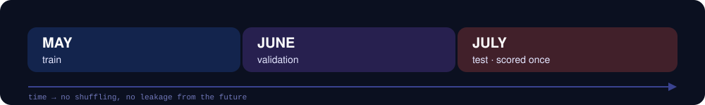
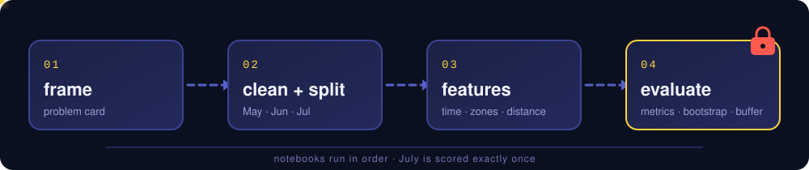
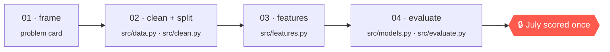

<div align="center">


<br>


**[The problem](#-the-problem)** · **[Pipeline](#-pipeline)** · **[Quick start](#-run-everything-from-a-fresh-clone)** · **[Layout](#-repository-layout)** · **[Results](#-results)** · **[AI use](#-ai-use-declaration)** · **[Team](#-team)**

</div>

---

## 🎯 The problem

> Predict the meter's `fare_amount` of a standard yellow-taxi trip **at booking time**, using only what is known before the ride starts: **pickup time**, **zones**, and **planned distance**.

| | |
|---|---|
| **Task** | Regression on `fare_amount` |
| **Information available** | Pickup time · pickup/dropoff zones · planned distance |
| **Information excluded** | Anything only known after the trip (actual duration, tips, tolls, final distance) |
| **Evaluation** | Out-of-time: the model never sees a later month than it is scored on |

Full framing lives in [`PROBLEM.md`](PROBLEM.md); model behaviour and limits in [`MODEL_CARD.md`](MODEL_CARD.md).

### Temporal split

<div align="center">

</div>

| Month | Role | Rule |
|---|---|---|
| **May** | Train | Fit and cross-validate here |
| **June** | Validation | Model selection and tuning |
| **July** | Test | **One** final scoring, enforced in code (`src.evaluate.lock_test`) |

---

## 🧭 Pipeline

<div align="center">

</div>

<br>



Notebooks are thin: all logic is imported from the `src/` package, so every stage is testable and re-runnable.

---

## 🚀 Run everything from a fresh clone

```bash
git clone <repo-url> && cd fairfare
python -m venv .venv && source .venv/bin/activate     # Windows: .venv\Scripts\activate
pip install -r requirements.txt
python data/get_data.py                                # downloads data/raw/
jupyter nbconvert --to notebook --execute --inplace notebooks/0*.ipynb   # or open them in order
```

**Order:** `01-frame` → `02-clean-and-split` → `03-features` → `04-evaluate`  
**Runtime:** ~__ min

> [!IMPORTANT]
> `04-evaluate` scores July **once** (`src.evaluate.lock_test`). To re-run it, delete `data/processed/.test_scored`.

<details>
<summary><b>Notebook guide</b></summary>

<br>

| # | Notebook | Purpose |
|---|---|---|
| 01 | `01-frame` | State the task, the prediction moment, and what may not leak |
| 02 | `02-clean-and-split` | Filter implausible trips, build the May / June / July split |
| 03 | `03-features` | Time, zone, and distance features |
| 04 | `04-evaluate` | Baselines vs. models, metrics, bootstrap intervals, buffer analysis, single July scoring |

</details>

---

## 🗂 Repository layout

```text
fairfare/
├── PROBLEM.md            problem card
├── MODEL_CARD.md         model card
├── notebooks/            the four stage notebooks (01 → 04)
├── src/
│   ├── data.py           load + temporal split
│   ├── clean.py          cleaning rules
│   ├── features.py       feature construction
│   ├── models.py         pipelines + baselines
│   └── evaluate.py       metrics, bootstrap, buffer, lock_test
├── data/
│   └── get_data.py       downloads raw data (data/raw/ is git-ignored)
└── media/                README assets
```

| Path | Contents |
|---|---|
| `PROBLEM.md`, `MODEL_CARD.md` | problem card, model card |
| `notebooks/` | the four stage notebooks |
| `src/` | `data.py` load/split, `clean.py` cleaning, `features.py`, `models.py` pipelines + baselines, `evaluate.py` metrics/bootstrap/buffer |
| `data/get_data.py` | downloads raw data (raw data is git-ignored) |

---

## 📊 Results

**July, scored once.**

<!-- Paste the headline table from NB04 here. Suggested columns: Model | MAE | RMSE | R² | 95% bootstrap CI -->

*(paste the headline table from NB04)*

---

## 🤖 AI use declaration

AI was used in this project; the specifics are to be elaborated.

- ...

---

## 👥 Team

| Member | Main responsibility |
|---|---|
| **Blevis Allushi** | |
| **Geri Belba** | |
| **Leandra Latifi** | |

<div align="center">

<sub>Project 1 · Task A "The Fare" · built with May, June, and exactly one July.</sub>

</div>