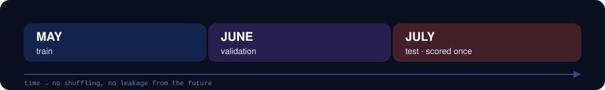
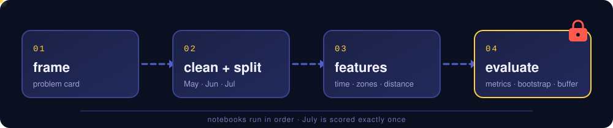
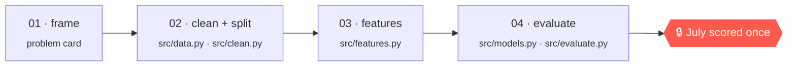

<div align="center">


<br>


**[The problem](#-the-problem)** · **[Pipeline](#-pipeline)** · **[Quick start](#-run-everything-from-a-fresh-clone)** · **[Layout](#-repository-layout)** · **[Results](#-results)** · **[Website](#-website)** · **[Report](#-report)** · **[AI use](#-ai-use-declaration)** · **[Team](#-team)**

</div>

---

## 🎯 The problem

> Predict the meter's `fare_amount` of a standard yellow-taxi trip **at booking time**, using only what is known before the ride starts: **pickup time**, **zones**, and **planned distance**.

| | |
|---|---|
| **Task** | Regression on `fare_amount` |
| **Information available** | Pickup time · pickup/dropoff zones · planned distance |
| **Information excluded** | Anything only known after the trip (actual duration, tips, tolls, final distance) |
| **Evaluation** | Out-of-time: the model never sees a later month than it is scored on |

Full framing lives in [`PROBLEM.md`](PROBLEM.md); model behaviour and limits in [`MODEL_CARD.md`](MODEL_CARD.md).

### Temporal split

<div align="center">

</div>

| Month | Role | Rule |
|---|---|---|
| **May** | Train | Fit and cross-validate here |
| **June** | Validation | Model selection and tuning |
| **July** | Test | **One** final scoring, enforced in code (`src.evaluate.lock_test`) |

---

## 🧭 Pipeline

<div align="center">

</div>

<br>



Notebooks are thin: all logic is imported from the `src/` package, so every stage is testable and re-runnable.

---

## 🚀 Run everything from a fresh clone

```bash
git clone <repo-url> && cd fairfare
python -m venv .venv && source .venv/bin/activate     # Windows: .venv\Scripts\activate
pip install -r requirements.txt                        # pinned versions the results were produced with
python data/get_data.py                                # downloads data/raw/ and verifies SHA-256 checksums
python -m tests                                        # protocol tests on synthetic data (no download needed)
cd notebooks && jupyter nbconvert --to notebook --execute --inplace 01-frame.ipynb 02-clean-and-split.ipynb 03-features.ipynb 04-evaluate.ipynb 05-routing-and-eda.ipynb
```

**Order:** `01-frame` → `02-clean-and-split` → `03-features` → `04-evaluate` → `05-routing-and-eda`  
**Runtime:** ≈ 20 min on a 16-core laptop (NB01–02: seconds; NB03 tuning grids: ≈ 18 min; NB04: ≈ 1 min; NB05: ≈ 30 s)

> [!IMPORTANT]
> `04-evaluate` scores July **once** (`src.evaluate.lock_test`): with `RUN_JULY = True` a second run raises. July was scored on 2026-11-01 by the early skeleton (before anything was frozen) and then, after a disclosed lock reset, once on **2026-11-15** with the frozen configuration. That run produced `results/july_*.json`. Re-running NB04 in this repository therefore stops at §4. In a fresh clone (no lock file) it reproduces the same numbers.

<details>
<summary><b>Notebook guide</b></summary>

<br>

| # | Notebook | Purpose |
|---|---|---|
| 01 | `01-frame` | State the task, the prediction moment, and what may not leak |
| 02 | `02-clean-and-split` | Filter implausible trips, build the May / June / July split |
| 03 | `03-features` | Time, zone, and distance features |
| 04 | `04-evaluate` | Baselines vs. models, bias, quote-rule choice, distance-noise sensitivity, single July scoring, slices, website aggregates |
| 05 | `05-routing-and-eda` | Straight-line distance estimate (fit May, test June) and descriptive statistics: quartiles, means, medians, most/least expensive trips and places |

</details>

---

## 🗂 Repository layout

```text
fairfare/
├── PROBLEM.md            problem card
├── MODEL_CARD.md         model card
├── PROJECT_ROADMAP.md    audit, milestones and their status
├── documentation/        LaTeX report (fairfare_report.pdf), its figures and generator script
├── notebooks/            the four stage notebooks (01 → 04)
├── results/              small committed outputs: June grids, Gate-2/3 freezes, July results
├── tests/                protocol tests (python -m tests)
├── site/                 project website (Vite + React + TypeScript, static)
├── src/
│   ├── data.py           load + temporal split
│   ├── clean.py          cleaning rules
│   ├── features.py       feature construction
│   ├── geo.py            taxi-zone shapefile reader, zone centroids
│   ├── routing.py        straight-line distance estimate (booking-time 'routing engine')
│   ├── eda.py            descriptive statistics for NB05 / the Data page
│   ├── config.py         paths, split, leakage blacklist, BOOKING_INPUTS, frozen model + quote rule
│   ├── models.py         pipelines + baselines
│   └── evaluate.py       metrics, bootstrap, quote rules, distance noise, lock_test
├── data/
│   └── get_data.py       downloads raw data (data/raw/ is git-ignored)
└── media/                README assets
```

| Path | Contents |
|---|---|
| `PROBLEM.md`, `MODEL_CARD.md` | problem card, model card |
| `notebooks/` | the four stage notebooks |
| `src/` | `data.py` load/split, `clean.py` cleaning, `features.py`, `models.py` pipelines + baselines, `evaluate.py` metrics/bootstrap/buffer |
| `data/get_data.py` | downloads raw data (raw data is git-ignored) |

---

## 📊 Results

**July 2026, scored once (2026-11-15), n = 128 359 trips.** Model: gradient boosting (`HistGradientBoostingRegressor`, absolute-error loss) on feature set `f7_time_x`, which includes target-encoded zones and zone pairs fitted inside the pipeline. Trained on May; every choice made on June. Intervals: 95% day-block bootstrap (2 000 resamples of whole days).

| Model | MAE | RMSE | bias (actual − pred.) |
|---|---|---|---|
| May median fare | \$7.716 | \$12.239 | +\$3.137 |
| Official meter rule, distance only (\$3 + \$3.50/mi) | \$4.496 | \$5.949 | +\$4.484 |
| Rate rule fitted on May (\$6.67 + \$3.99/mi) | \$2.828 | \$3.796 | −\$0.479 |
| Depth-2 tree | \$3.816 | \$5.173 | −\$0.480 |
| **Fairfare** | **\$2.002** (1.925 – 2.086) | **\$2.959** (2.823 – 3.124) | −\$0.105 |

- vs the fitted rate rule: **−\$0.83 MAE per trip** (95% CI −0.88 to −0.77); vs the median: −\$5.71 (−5.85 to −5.57).
- **Quote = prediction + a buffer per distance band** (chosen on June for 90% coverage): July coverage **92.6%**, average cushion \$4.03. Every slice with ≥ 500 trips reaches ≥ 90%; trips over 20 mi (n = 201) only reach 72%.
- Details, slices and limitations: [`MODEL_CARD.md`](MODEL_CARD.md). Every decision and its evidence: [`PROBLEM.md`](PROBLEM.md) and the notebooks.

---

## 🌐 Website

`site/` is a static website (Vite + React + TypeScript, no backend). It has a live **fare predictor**, plus methodology, **data** (quartiles, means, medians, the most expensive and cheapest trips and places, and why), model, results and analytics pages. All numbers are read from files exported from `results/`.

**Browser inference.** The predictor runs the real trained model in the browser. `site/scripts/export_data.py` refits the frozen pipeline on May (deterministic) and writes its one-hot categories, target-encoder tables and all 300 trees to `site/public/data/model.json`. `site/src/lib/model.ts` re-implements the feature code and tree traversal in TypeScript, and `npm run test:parity` checks it against scikit-learn on 2 000 June trips (maximum difference: 0). ONNX was not used: the feature step is a custom Python `FunctionTransformer`, which ONNX converters cannot translate, and the onnxruntime-web runtime would add several MB. **Distance at booking.** The predictor estimates the route as the straight line between the two zone centres × a detour factor learned on May for trips of that straight-line length (1.17–1.79; `src/routing.py`, also re-implemented in TypeScript and parity-tested). On June this costs accuracy: MAE \$3.26 vs \$2.08 with the odometer distance. Estimated distances therefore get their own June-calibrated quote buffers (90.0% cross-fitted June coverage, average cushion \$5.27). This mode was evaluated on June only; July was not re-used. A distance typed by the user switches back to the original buffers. Limits: the model file is ≈ 3 MB (≈ 1.1 MB gzipped).

```bash
python site/scripts/export_data.py   # (only after re-running the pipeline) regenerate site/public/data from results/ + data/raw
cd site
npm ci                               # exact dependency versions from package-lock.json
npm run test:parity                  # browser model == Python model
npm run dev                          # http://localhost:5173/Fairfare/
npm run build && npm run check:links # production build in site/dist + asset/route check
npm run preview                      # serve the production build at http://localhost:4173/Fairfare/
```

### Publishing on GitHub Pages (manual, owner only)

Nothing is deployed automatically. The workflow [`.github/workflows/deploy-site.yml`](.github/workflows/deploy-site.yml) runs **only** when started by hand and only when you type `deploy`. It builds with base path `/<repository name>/` (here `/Fairfare/`), runs the parity test and the dist check, and publishes `site/dist`.

1. Commit and push the changes to `main` yourself.
2. On GitHub: **Settings → Pages → Build and deployment → Source: "GitHub Actions"**.
3. **Actions → "Deploy website" → Run workflow**, type `deploy` in the confirmation box, and run it.
4. The site appears at `https://<owner>.github.io/Fairfare/` (here `https://blevis.github.io/Fairfare/`). The routes use `#/…` hashes, so reloads and deep links work without server rewrites.

For a custom domain or a user site (`<owner>.github.io` repository), build with `BASE_PATH=/`.

---

## 📄 Report

The full scientific write-up is [`documentation/fairfare_report.pdf`](documentation/fairfare_report.pdf) (LaTeX source alongside). Every number, table and figure in it is generated from `results/` and the May/June data by [`documentation/make_report_assets.py`](documentation/make_report_assets.py):

```bash
python documentation/make_report_assets.py           # figures/ + generated/{numbers,tables}.tex
cd documentation && tectonic fairfare_report.tex     # or: pdflatex fairfare_report.tex (twice)
```

---

## 🤖 AI use declaration

Generative AI (Anthropic's Claude, used through the Claude Code assistant) was used in this project:

- **Website (`site/`):** generated with AI from our specifications, including the in-browser port of the model and its parity test.
- **Code:** AI worked from the pipeline the team had already written (data loading, cleaning, the first feature sets, baselines and evaluation helpers) and helped extend it: additional feature sets and model options, the quote-rule and distance-perturbation helpers, the protocol tests, the straight-line distance estimator and the website's data-export script.
- **Text:** help editing the notebook narratives and the Markdown documentation.

Every methodological decision (population scope, temporal protocol, selection rules, the reset of the July lock) was made or explicitly approved by the team. Blevis Allushi reviewed all AI-produced code, ran every analysis and checked the reported numbers against the executed outputs. All results come from code executed in this repository; none were produced or edited by hand.

---

## 👥 Team

| Member | Lead area | Contribution |
|---|---|---|
| **Blevis Allushi** | Project lead, protocol and pipeline | Repository, `src/` package and five-stage pipeline; evaluation protocol (temporal split, pre-stated selection rules, single-use July lock); data acquisition, cleaning and population definition; hyperparameter tuning and the single July run; booking-time distance (routing) study; direction of the website; LaTeX report. |
| **Geri Belba** | Features and leakage | May exploratory analysis (fare per mile by hour, weekday, borough and zone; airport trips) that motivated the time and zone features; the cumulative feature ladder and its June ablation, including the target-encoded zone pair and distance × time-of-week interactions; leakage audit of every feature; review of the distance-noise sensitivity analysis. |
| **Leandra Latifi** | Evaluation and the quote | Baseline ladder (median, fitted rate rule, shallow tree) and slice analysis; comparison of quote rules (additive, multiplicative, per distance band) with odd/even-day cross-fitting on June; July coverage and failure-mode analysis (slow traffic, 20+ mi trips, airports); model card. |

<div align="center">

<sub>Project 1 · Task A "The Fare" · built with May, June, and exactly one July.</sub>

</div>